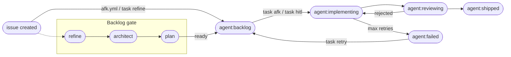

# python-uv-template

Copier-based Python project scaffold. Generates a production-ready structure with structured logging, typed config, AI-assisted commit messages, test coverage mirroring `src/`, and GitHub Actions CI — ready to `uv sync` and go.

## SDLC Maturity

**Current: 3.50 / 10 — Junior AI Engineer** · Assessed: 2026-06-27 · Artifact: [`docs/assessment-2026-06-27.md`](docs/assessment-2026-06-27.md)

> Re-assess: load [`ASSESSMENT_PROMPT.md`](ASSESSMENT_PROMPT.md) into a Claude Code session, then update this table.

| Stage | Role | Criteria | Status |
|---|---|---|---|
| **0–2** | AI Student / Hobbyist | 8 / 8 | ✅ All criteria met |
| **3–4** | Junior AI Engineer ◄ | 5 / 7 | 🔲 `dependabot.yml` missing `docker` ecosystem · SHA-pin `build.yml` + `deploy.yml` third-party actions |
| **5–6** | Medior AI Engineer | 8 / 12 | 🔲 `CONTEXT.md` codifies SOLID/DRY/KISS/TDD · skill dirs gain `REFERENCE.md`/`EXAMPLES.md`/`scripts/` · diagnosis skill · progressive-disclosure docs under `docs/` |
| **7–8** | Senior AI Engineer | 4 / 10 | 🔲 `CODEOWNERS` covers SECURITY.md/CODEOWNERS/adr/workflows · `SECURITY.md` disclosure + agent permission model · pre-commit harness · codebase-map generator · LLM-optimized error wrapper · agent file-path enforcement |
| **9–10** | Principal AI Engineer | 2 / 13 | 🔲 Cross-family adversarial review · Hypothesis PBT · LLM-judge harness · EU AI Act lineage + telemetry · CI-failure diagnose-and-patch agent |

**Score formula:** tier-gated binary checklist. All criteria in tier N must be met before tier N+1 points are awarded. Within the blocking tier: `base + (met/total × 2)`. Full criteria in [`ASSESSMENT_PROMPT.md`](ASSESSMENT_PROMPT.md).

---

## Table of Contents

- [SDLC Maturity](#sdlc-maturity)
- [Quickstart](#quickstart)
  - [5-Minute AFK Setup](#5-minute-afk-setup)
  - [Orchestration Issue → PR Flow](#orchestration-issue--pr-flow)
  - [Generate a new project](#generate-a-new-project)
- [Validate the template end-to-end](#validate-the-template-end-to-end)
- [Repository Structure](#repository-structure)
- [Conventions](#conventions)
- [AI Workflow](#ai-workflow)
- [Advanced / Self-hosted opt-in](#advanced--self-hosted-opt-in)

---

## Quickstart

### 5-Minute AFK Setup

The fastest path from zero to autonomous AI development:

**1. Fork** this repository.

**2. Set two repository secrets** (Settings → Secrets and variables → Actions):

| Secret | How to obtain |
|--------|--------------|
| `CLAUDE_CODE_OAUTH_TOKEN` | From [claude.ai/settings](https://claude.ai/settings) → API keys |
| `GH_TOKEN` | Classic PAT with `project`, `read:org`, `repo`, `user`, `workflow` scopes |

**3. Run setup** to configure the kanban board and register `KANBAN_RUNNER_PROFILE=hosted` (the GHA-hosted default):

```bash
task setup
```

**4. Create an issue** — `afk.yml` automatically refines, architects, and plans it, then grants `agent:backlog` once it is ready (`task refine` does the same locally, or for backfill).

**5. Walk away** — run `task afk` to drain the `agent:backlog` queue: the orchestrator runs branch → implement → review → ship autonomously on `ubuntu-latest` using your `CLAUDE_CODE_OAUTH_TOKEN`. Granting `agent:backlog` does **not** auto-start work — you trigger processing, so "ready" and "go" stay separate (ADR-014).

> **`GH_TOKEN` scope requirement:** Must be a **classic PAT** with all five scopes: `project`, `read:org`, `repo`, `user`, `workflow`. Fine-grained PATs do not support GitHub Projects v2. Missing scopes cause silent failures at runtime — `project` breaks kanban board mutations, `workflow` blocks any PR that touches `.github/workflows/*.yml`, `read:org` is required for org-owned projects, `user` for identity calls, and `repo` for issue/PR/commit operations.

### Orchestration Issue → PR Flow



### Generate a new project

To scaffold a new project from this template:

**1. Install prerequisites** — once, globally:

```bash
uv tool install copier                        # project generator
winget install --id Microsoft.PowerShell      # PowerShell 7 (Windows)
```

**2. Generate**

```bash
uvx copier copy gh:your-username/my_template_repo path/to/new-project
```

Copier will prompt for:
- `project_name` — hyphenated name (e.g. `my-new-project`)
- `description` — one-line project description
- `project_type` — target project type: `application` (default), `agent`, or `ml`

**3. Replace the logging stub**

```bash
# Drop your m_log.py into src/utils/ — interface: f_log(), setup_logging(), f_log_execution()
```

---

## Validate the template end-to-end

After generating a new project, confirm the hello-world server starts and responds correctly before writing your first feature.

**1. Build the image**
```bash
docker build -t <name>:dev .
```

**2. Start the container**
```bash
docker run --rm -p 8000:8000 <name>:dev
```

**3. Open the root route in a browser**

Navigate to `http://localhost:8000` — you should see an HTML page with the project name and version.

**4. Check the health endpoint**
```bash
curl http://localhost:8000/healthz
```

Expected response: `ok`

The hello-world handler in `src/main.py` is intentionally minimal — it is the starting point for your first feature, not production code. Replace `HelloHandler` with your own request logic and delete or extend the `/healthz` route to match your application's health semantics.

---

## Repository Structure

```
my_template_repo/
├── copier.yml                    Prompt definitions and generation config
├── LICENSE
├── README.md                     This file
├── main.py                       Entry point (templated)
├── pyproject.toml                Project metadata and dependencies
├── src/
│   ├── config.py                 Centralised config (pydantic-settings, loads .env)
│   └── utils/                    Generic transferable modules (m_*.py)
├── tests/                        Pytest suite, mirrors src/ hierarchy
├── .agents/skills/               Skill system — AI workflow for every generated project
├── .github/
│   ├── workflows/                checks.yml (lint, typecheck, test, guards) + afk.yml (the pipeline)
│   ├── orchestrator/             The module — Import-Module Orchestrator
│   │   ├── stages/               One file per stage: Refine, Architect, Plan, Implement, Review, Ship
│   │   ├── engines/              LLM adapters: Claude.ps1, Gemini.ps1
│   │   └── lib/                  Config.ps1, GitHub.ps1, Util.ps1, Grill.ps1
│   ├── tasks/                    One runnable per Taskfile target
│   └── checks/                   Validators run by checks.yml (check-*.ps1)
├── docs/adr/                     Architecture Decision Records (MADR format)
├── CONTEXT.md                    Domain glossary template (filled at generation time)
└── AGENTS.md                     Agent standing instructions (filled at generation time)
```

---

## Conventions

- **Utility modules**: `m_*.py` naming in `src/utils/` — generic, no project-specific logic
- **Domain folders**: add `src/<domain>/` as the project grows — never pollute `src/utils/`
- **Test parity**: every `src/**/*.py` gets a matching `tests/**/test_*.py`
- **Python 3.13**: required interpreter — install via `uv python install 3.13` (see [Quickstart §1](#quickstart))
- **UV only**: `uv add`, `uv sync`, `uv run` — never `pip install`
- **Native Secret Management**: uses local vault named 'LocalStore' for secret management

---

## AI Workflow

Every generated project ships with a structured AI engineering workflow. It is not optional scaffolding — it is the primary mechanism for keeping agents aligned, context-efficient, and audit-ready across the full development lifecycle.

### How it works

The workflow is six stages, in order: **refine → architect → plan → implement → review → ship**. Each stage has one skill, one library script and — for the last three — one label, all of the same name (ADR-015). Each skill is a constraint document that prevents a specific class of agent failure. Skills live in `.agents/skills/`.

| Stage | Skill | What it prevents |
|-------|-------|-----------------|
| refine | `refine` | Premature implementation without shared language or agreed boundaries |
| architect | `architect` | Blind changes with unknown blast-radius |
| plan | `plan` | Coding without acceptance criteria or re-proposing rejected ideas |
| implement | `implement` | Untested code and shallow module design |
| review | `review` | Uncaught regressions and principle violations before merge |
| ship | `ship` | Security gaps, supply chain risk, lost architectural decisions |

TDD is the *method* of `implement`, not the name of the stage — so the discipline can change without renaming the stage, the script or the label.

**Cross-cutting, loaded on demand:** `version-control` (branch naming, commit format, PR conventions) and `diagnosis` (root-cause isolation before a fix).

**Domain extensions** (extend the `implement` REFACTOR stage with implementation patterns):
- `application-engineering` — AI-backed REST APIs, single-call Claude integration, OTel, SSE, auth
- `data-engineering` — Medallion pipeline, SQLAlchemy, Polars, DuckLake
- `agentic-engineering` — Plan-Act-Observe loops, tool use, multi-agent coordination

Environment provisioning and context-window health are not stages — no issue ever sits in them. See `docs/HARNESS.md`.

### Key files in every generated project

| File | Purpose |
|------|---------|
| `CONTEXT.md` | Domain glossary, bounded contexts, architectural constraints — read first every session |
| `AGENTS.md` | Standing instructions and skill index — loaded after `CONTEXT.md` |
| `docs/adr/` | Architecture Decision Records (MADR format) — one per significant technology choice |

### Starting a new feature

```
1. Open CONTEXT.md — read the glossary and constraints
2. Invoke refine skill — align on requirements and boundaries
3. Invoke architect skill — understand blast-radius before touching code
4. Invoke plan skill — decompose into GitHub Issues
5. Invoke implement skill — Red-Green-Refactor loop
6. Invoke review skill — auto-fix and validate before merge
7. Invoke ship skill — security checks, squash merge, update CONTEXT.md
```

ADRs for tool selection decisions are in `docs/adr/`. See `ADR-000` for the template format.

---

### Orchestrator Workflow

The Orchestrator Workflow is the autonomous execution layer. It splits into two flows (ADR-014): a **pre-backlog alignment gate** that makes an issue ready, and **processing** that ships it. Alignment is automatic; processing is something you trigger — granting `agent:backlog` means "ready", not "go".

> **How it's built:** the orchestrator is a PowerShell module at `.github/orchestrator/` (`Import-Module Orchestrator`), with one file per stage in `stages/`. `Orchestrator.psm1` is the single conductor — `Invoke-Orchestration -From refine|implement` — and `Orchestrator.psd1` declares the public surface explicitly. The `task` commands below are runnables in `.github/tasks/` that import it; `afk.yml` imports it on the runner. Run parameters flow via environment variables into `Get-OrchestratorContext` (ADR-013), so nothing relies on fragile script-scope state.

#### State machine

The board is a 4-lane FSM (ADR-011). The alignment gate runs *before* the backlog and grants the `agent:backlog` label; from there an issue carries exactly one `agent:` label, matching its board lane.

```
issue created
     │  afk.yml / task refine  (refine → architect → plan; artefacts written into the issue body)
     ▼  ── gate: refined + architected + planned + zero open questions ──
agent:backlog ───► agent:implementing ───► agent:reviewing ───► agent:shipped
     ▲   task afk / task hitl    │            │
     │                               │ (rejected)  │ (max retries)
     │                               ▼            ▼
     └────────────────── agent:implementing ◄── agent:failed
```

| Label | Lane | Meaning |
|---|---|---|
| _(no label)_ | Backlog | Un-aligned — the gate has not yet granted readiness |
| `agent:backlog` | Backlog | Aligned and **ready** — `task afk`/`task hitl` will process it |
| `agent:implementing` | Implementing | Branch created, Claude Code implementing (Develop → PR) |
| `agent:reviewing` | Review | PR open, agent self-review running or passed |
| `agent:shipped` | Shipped | PR squash-merged, issue closed |
| `agent:failed` | Backlog | Unrecoverable error or max retries exceeded — human required |

Refine, architect, and plan are readiness flags in the issue-carried state, not lanes — they run in the gate and leave their artefacts (`Architecture Impact`, `Implementation Plan`, `Agent Brief`) in the issue body.

#### Transitions

| Event | From → To |
|---|---|
| `task sync` | issue created → Backlog, **un-aligned** (no `agent:*` label) |
| `afk.yml` (on issue created) or `task refine` | runs refine → architect → plan → grants `agent:backlog` when ready |
| Open questions remain | `agent:backlog` withheld; human:decision child issue raised — resolve, then re-run align |
| `task afk` (cloud) / `task hitl` (local) | `agent:backlog` → `agent:implementing` |
| PR opened, review begins | `agent:implementing` → `agent:reviewing` (lane moves immediately) |
| Review passes | stays `agent:reviewing` until orchestrator merges |
| Review rejected | `agent:reviewing` → `agent:implementing` (orchestrator retries implement) |
| Max retries exceeded (default: 3) | → `agent:failed` + Backlog lane |
| Orchestrator merges | `agent:reviewing` → `agent:shipped` |
| `task retry ISSUE=N` | any state → `agent:backlog` (recovery) |

#### Task commands

```bash
task sync                   # parse ISSUES.md and push pending blocks to GitHub Issues (un-aligned)
task refine                  # Backlog gate — align every un-aligned issue (grants agent:backlog when ready)
task refine ISSUE=13         # align just issue #13
task hitl                  # Local — interactive Backlog picker; runs full orchestration here
task hitl ISSUE=13         # Local orchestration for issue #13, skipping the picker
task afk                 # Cloud runner — dispatch GHA to drain the whole agent:backlog queue (laptop can be closed)
task retry ISSUE=13         # reset a stuck or failed issue back to agent:backlog
```

`task afk` drains the `agent:backlog` queue **lowest issue number first**. Local runs use the interactive picker.

#### Issue body template

Issues used with the Orchestrator Workflow should follow the structure defined in `ISSUES.md`. The alignment gate's refine step applies the template automatically if the body is missing required fields, and assigns Estimate (Fibonacci SP) and Priority project fields if absent — so every issue that reaches `agent:backlog` is fully specified, architected, and planned.

---

## Advanced / Self-hosted opt-in

For teams running their own GitHub Actions runner or needing full local control over the orchestration environment.

### `KANBAN_RUNNER_PROFILE` variable

Controls which runner executes the AFK orchestration lane. Set as a GitHub Actions repository variable (Settings → Variables → Actions).

| Value | Runner | When to use |
|-------|--------|-------------|
| `hosted` (default) | `ubuntu-latest` | Anyone with a Claude Max subscription — no local setup needed |
| `self-hosted` | `[self-hosted, gha-project]` | Cost-sensitive users who want to run on their own machine |

`task setup` sets this to `hosted` automatically. To switch after setup:

```bash
gh variable set KANBAN_RUNNER_PROFILE --body 'self-hosted'
```

### Wire up the Orchestrator Workflow

**1. Install prerequisites**

```bash
winget install --id Task.Task                 # Taskfile runner
```

**2. Create a GitHub Project**

Create a GitHub Project (Projects v2, Kanban board) with a **Status** field containing at least: `Backlog`, `Implementing`, `Review`, `Shipped`.

**3. Configure local environment**

Set the two required values in `.env`:
```
KANBAN_PROJECT_NUMBER=<your project number>
KANBAN_PROJECT_OWNER=<your GitHub username or org>
```

**4. Run setup**

Auto-discovers field IDs and sets GitHub Actions variables:
```bash
task setup
```

> `task setup` will warn if your local `gh auth` context lacks the `project` scope, but that does not verify the secret — check the PAT settings page directly.

### Self-hosted runner

With `KANBAN_RUNNER_PROFILE=self-hosted`, the `implement` job targets a runner registered with the `[self-hosted, gha-project]` labels. Register and run it yourself — pre-install `uv`, `claude`, `git`, and `gh`:

1. **Register** — repository Settings → Actions → Runners → **New runner**, adding the custom label `gha-project`. See the [GitHub docs on self-hosted runners](https://docs.github.com/en/actions/hosting-your-own-runners).
2. **Run** — start `./run.cmd`, or install it as a service (`svc.cmd install`) for unattended operation.

`task afk` dispatches the backlog queue to whichever runner the profile selects — it does **not** start the runner process itself.

---
