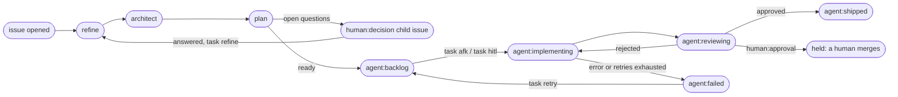

# python-uv-template

Copier-based Python 3.13 + UV project scaffold with typed config, structured logging, test
parity, GitHub Actions CI, and an agentic pipeline that takes a GitHub issue from idea to merged
PR — refine → architect → plan → implement → review → ship.

**SDLC maturity:** 3.50 / 10 (Junior AI Engineer), assessed 2026-06-27 —
[`docs/assessment-2026-06-27.md`](docs/assessment-2026-06-27.md). To re-assess, load
[`ASSESSMENT_PROMPT.md`](ASSESSMENT_PROMPT.md) into a Claude Code session and update this line.

| Document | Holds |
|---|---|
| [`CONTEXT.md`](CONTEXT.md) | Glossary, Module Map, architectural constraints — what the project *is* |
| [`AGENTS.md`](AGENTS.md) | Standing instructions and skill index for AI agents |
| [`SECURITY.md`](SECURITY.md) | Secrets, accepted risks, and how to halt, override or roll back the agents |
| [`ISSUES.md`](ISSUES.md) | Issue format, estimate and priority scales, local backlog |
| [`docs/adr/`](docs/adr/ADR_STRUCTURE.md) | Architecture Decision Records |

---

## Generate a project

Prerequisites: [uv](https://docs.astral.sh/uv/), [Task](https://taskfile.dev),
PowerShell 7+, and the GitHub CLI (`gh`).

```bash
uvx copier copy gh:your-username/my_template_repo path/to/new-project
```

Copier prompts for `project_name`, `description`, and `project_type` (`application` — the
default, `agent`, or `ml`). Then `uv sync` and `uv run pytest`.

To check the hello-world server: `docker build -t app:dev . && docker run --rm -p 8000:8000 app:dev`,
then open `http://localhost:8000` (project page) and `curl http://localhost:8000/healthz` (`ok`).
Replace `HelloHandler` in `src/main.py` with your first feature.

---

## Set up the pipeline

1. **Create a GitHub Project (v2)** with a single-select **Status** field: `Backlog`,
   `Implementing`, `Review`, `Shipped`. Optionally add **Estimate** (number) and **Priority**
   (single-select `P0`–`P4`).
2. **Fill `.env`** (copy `.env.example`): `GH_TOKEN`, `KANBAN_PROJECT_NUMBER`,
   `KANBAN_PROJECT_OWNER`.
3. **Add two repository secrets** (Settings → Secrets and variables → Actions): `GH_TOKEN` and
   `CLAUDE_CODE_OAUTH_TOKEN`. What each needs and how to rotate it: [`SECURITY.md`](SECURITY.md).
4. **Run `task setup`** — discovers the board's field IDs, writes them to `.env` and to repository
   variables, provisions the `agent:*` / `human:*` labels, and sets `KANBAN_RUNNER_PROFILE=hosted`.

---

## How the pipeline works



- **Refine → architect → plan** runs automatically when an issue is opened and writes its output
  (Agent Brief, Architecture Impact, Implementation Plan) into the issue body. It grants
  `agent:backlog` only when no open questions remain.
- **Implement → review → ship** starts only when you trigger it: `agent:backlog` means *ready*,
  not *go* (ADR-014). `task afk` drains the whole queue in the cloud, oldest issue first, so the
  laptop can be closed.
- Review may send work back to implement up to `KANBAN_MAX_RETRIES` times (3 in the cloud, 2
  locally by default); after that the issue lands on `agent:failed`.
- Ship waits for CI, squash-merges, and updates `CONTEXT.md`. An issue labelled `human:approval`
  stops before the merge.

| Label | Board lane | Meaning |
|---|---|---|
| _(none)_ | Backlog | Not yet aligned |
| `agent:backlog` | Backlog | Aligned and ready to process |
| `agent:implementing` | Implementing | Branch created, agent implementing |
| `agent:reviewing` | Review | PR open, self-review running or passed |
| `agent:shipped` | Shipped | PR squash-merged, issue closed |
| `agent:failed` | Backlog | Needs a human — see `failed_at` in the issue body |
| `human:approval` | — | Implement and review unattended; a human merges |
| `human:decision` | — | A question for a human, never a work item |

To halt, override or roll back anything the pipeline does, see
[`SECURITY.md` § Human Oversight](SECURITY.md#human-oversight).

### Commands

```bash
task sync              # push ISSUES.md blocks to GitHub Issues (each then triggers refine)
task refine [ISSUE=N]  # align one issue, or every un-aligned one
task afk               # cloud: drain the agent:backlog queue
task hitl [ISSUE=N]    # local: pick a backlog issue and run it in this terminal
task retry ISSUE=N     # resume a failed or stuck issue
task setup             # one-time board, label and variable setup
task protect           # apply branch protection to main
```

In a browser or on your phone, Actions → **AFK** → **Run workflow** runs a single stage
(`refine`, `implement` or `ship`) for an issue number.

### Runner profile

`KANBAN_RUNNER_PROFILE` (a repository variable) selects where the refine and implement jobs run:
`hosted` (default, `ubuntu-latest`) or `self-hosted` (a runner you register with the label
`gha-project`, with `uv`, `claude`, `git`, `gh` and `pwsh` installed). Switch with
`gh variable set KANBAN_RUNNER_PROFILE --body self-hosted`. `task afk` dispatches work — it does not
start a self-hosted runner.

---

## AI workflow

Every generated project ships the same six stages as skills in `.agents/skills/`, invoked
interactively in that order or run unattended by the orchestrator. Each skill prevents a class of
agent failure:

| Stage | Prevents |
|---|---|
| `refine` | Implementing before language and boundaries are agreed |
| `architect` | Changes with an unknown blast radius |
| `plan` | Coding without acceptance criteria, or re-proposing rejected ideas |
| `implement` | Untested code and shallow module design (method: TDD) |
| `review` | Regressions and principle violations reaching the merge |
| `ship` | Security gaps, supply-chain risk, lost architectural decisions |

The full skill index — including cross-cutting and domain skills — is in [`AGENTS.md`](AGENTS.md).

## Repository structure

```
src/                  application code — main.py, config.py, utils/ (generic m_*.py), tools/
tests/                pytest suite mirroring src/
.agents/skills/       one directory per skill
.github/orchestrator/ the pipeline — stages/, engines/, lib/ (PowerShell module)
.github/tasks/        one runnable per Taskfile target
.github/checks/       validators run by checks.yml
.github/workflows/    checks.yml (CI gates), afk.yml (the pipeline), build, deploy
docs/                 ADRs and conditional agent context (TESTING, SKILLS)
```

The Module Map in [`CONTEXT.md`](CONTEXT.md) is the authoritative index.
